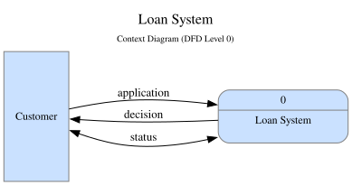
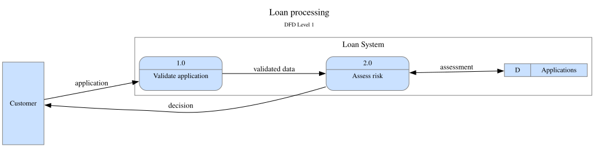

# DFD-PlantUML

The official PlantUML library for Level 0 context diagrams and Level 1 data-flow diagrams. It generates Graphviz DOT through PlantUML macros. Experiments live in [ArmanAvanesyan/test](https://github.com/ArmanAvanesyan/test); official library files never import that repository.

## Installation


Download `DFD.puml`, `DFD_Level_0.puml`, and `DFD_Level_1.puml` from the same commit into one directory. Include the desired profile locally. No edits to its sibling include are needed. Choose one profile per diagram.

For remote use, set `$DFD_ROOT` to the directory of one full source commit, then include its profile (replace `COMMIT_SHA`):

```text
@startdot
!$DFD_ROOT = "https://raw.githubusercontent.com/ArmanAvanesyan/DFD-PlantUML/COMMIT_SHA"
!includeurl $DFD_ROOT/DFD_Level_0.puml
startDfd()
External(User, "Customer")
Process(System, "Loan System")
Flow(User, System)
endDfd()
@enddot
```

Use `DFD_Level_1.puml` for Level 1. Both files resolve through the same commit-pinned `$DFD_ROOT`; local installs use sibling includes. See [installation](docs/INSTALLATION.md) and [renderer compatibility](docs/COMPATIBILITY.md). Bundled `<dfd/...>` installation is proposed and is unavailable in existing official PlantUML releases.

## Examples


The following snippets are the executable files under `examples/`; their relative includes assume that directory layout. CI checks that these blocks remain identical to the files.

### Level 0



```plantuml
@startdot
!include ../DFD_Level_0.puml
startDfd(Loan System)
External(Customer, "Customer")
Process(System, "Loan System")
Flow(Customer, System, "application")
Flow_Back(Customer, System, "decision")
BiFlow(Customer, System, "status")
endDfd()
@enddot
```

### Level 1



```plantuml
@startdot
!include ../DFD_Level_1.puml
startDfd(Loan processing)
External(Customer, "Customer")
Process("Loan System")
SubProcess(Validate, "1.0", "Validate application")
SubProcess(Assess, "2.0", "Assess risk")
DataStore(Applications, "Applications")
DataFlows()
Flow(Customer, Validate, "application")
Flow(Validate, Assess, "validated data")
BiFlow(Assess, Applications, "assessment")
Flow_Back(Customer, Assess, "decision")
endDfd()
@enddot
```

`Process(label)` opens the Level 1 boundary; `DataFlows()` closes it before the external flows. Level 0 instead uses `Process(alias, label, id="0")` to create its central node. Existing published call signatures are retained.

## Customization

Setters apply to subsequent output; set graph properties before `startDfd()`. The [API reference](docs/API.md) documents signatures, defaults, label escaping, styling, and opt-in validation.

```plantuml
@startdot
!include ../DFD_Level_0.puml
SetTitleFontColor("#234567")
SetSubtitleFontColor("#345678")
SetExternalFillColor("#FFFDE7")
SetProcessFillColor("#E3F2FD")
SetProcessSize("2.5", "1.2")
SetComponentFontSize(14)
SetAllFlowProperties("dashed", "#BB2222", "#234567", 12, 2)
SetRankDir("TB")
SetRankSep("1.2")
SetSplines("polyline")
SetValidation(1)
startDfd(Customized diagram)
External(User, "Customer")
Process(System, "Loan System", "0")
Flow(User, System, "request")
BiFlow(System, User)
endDfd()
@enddot
```


## Documentation and checks

- [Installation](docs/INSTALLATION.md), [API](docs/API.md), and [compatibility](docs/COMPATIBILITY.md).
- [Architecture](docs/ARCHITECTURE.md), [migration](docs/MIGRATION.md), and [stdlib status](docs/STDLIB.md).
- [Contribution guide](CONTRIBUTING.md) and [release preparation](docs/RELEASING.md).

Run `python3 -m unittest discover -s tests -v`, then `python3 scripts/check.py --toolchain baseline` and `python3 scripts/check.py --toolchain current` from a checkout with Python 3.10+ and Docker. See the compatibility and release guides for remote and archive verification.

Level 0–1 is implemented. Level 2, alternate notations, automatic hierarchy linking, and experimental `DFD_INIT`/uniform `DFD_*` APIs remain outside the supported library. Experiments stay in the testing repository.

No new release number is assigned. Publication is a separate manual action. License: [MIT](LICENSE).
